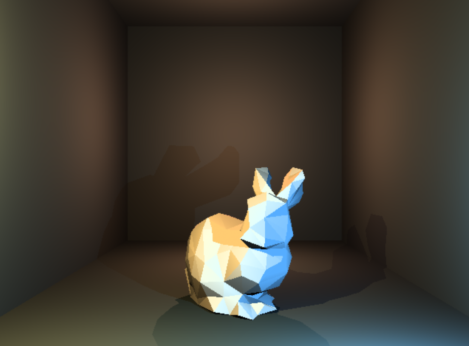

# Software Raytracer

A CPU-based software raytracer written in C++20, rendering directly into an
SDL2 window surface. Supports analytic sphere/plane primitives as well as
triangle meshes (`.obj`), with a physically based Cook-Torrance BRDF for
metal/dielectric shading alongside simpler Lambert and Phong materials.



## Features

- Multi-threaded per-pixel rendering (`std::execution::par`)
- Primitives: spheres, planes, and triangle meshes (with BVH-free
  ray/triangle intersection and configurable culling)
- `.obj` mesh loading (see `project/resources`)
- Point and directional lights
- Materials:
  - `Material_SolidColor`
  - `Material_Lambert`
  - `Material_LambertPhong`
  - `Material_CookTorrence` — full PBR pipeline:
    - Trowbridge-Reitz GGX normal distribution
    - Smith geometry function (Schlick-GGX)
    - Schlick Fresnel approximation
    - Metalness/roughness workflow
- Free-fly camera with mouse + keyboard navigation
- Toggleable shadows and light-equation debug views
- Screenshot export to `.bmp`

## Building

Requirements:
- CMake 3.27+
- A C++20 compiler (MSVC recommended on Windows)

The project bundles its dependencies (SDL2, SDL2_image) under
`project/libs`, so no external package installation is required.

```
cmake -B out -S .
cmake --build out
```

Optional DirectX 11 support can be enabled via:

```
cmake -B out -S . -DDIRECTX_11_ENABLED=ON
```

The executable and required DLLs/resources are copied automatically to the
build output directory.

## Controls

### Camera

| Input | Action |
|---|---|
| `W` / `Up Arrow` | Move forward |
| `S` / `Down Arrow` | Move backward |
| `A` / `Left Arrow` | Move left |
| `D` / `Right Arrow` | Move right |
| `E` | Move up |
| `Q` | Move down |
| `Left Shift` (held) | Speed boost (5x) |
| `Right Mouse Button` + move | Look around (yaw/pitch) |
| `Right Mouse Button` + `WASD` | Fly (look + move simultaneously) |
| `Left Mouse Button` + drag vertically | Move forward/backward |
| `Left Mouse Button` + drag horizontally | Yaw |
| `Left Mouse Button` + `Right Mouse Button` + drag | Pan (truck/pedestal) |

### Rendering / Debug

| Key | Action |
|---|---|
| `F2` | Toggle shadows on/off |
| `F3` | Cycle light-equation debug mode (`Full` → `Observed Area` → `Radiance` → `BRDF` → `Full`) |
| `X` | Save the current frame to `RayTracing_Buffer.bmp` |
